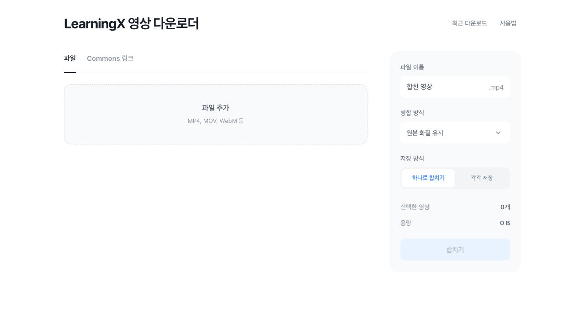
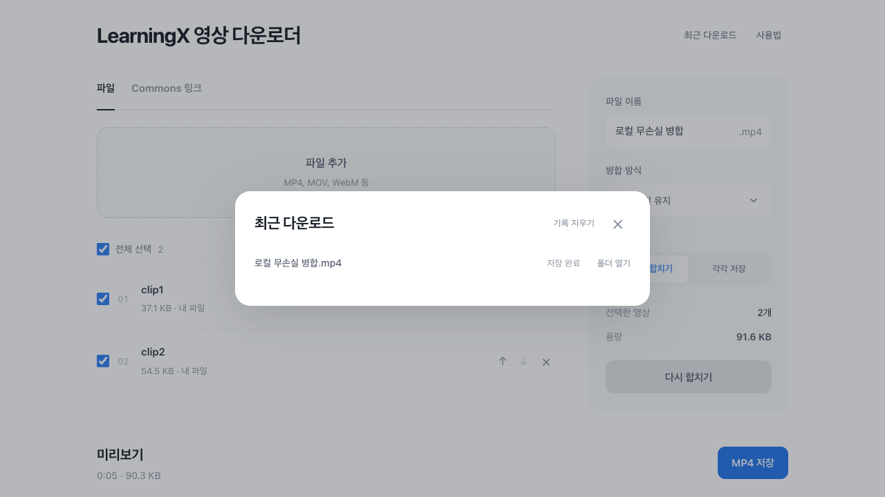
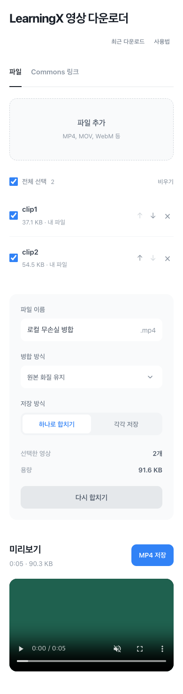

# LearningX 영상 다운로더

**강의 옆에서 한 번 클릭. 조각 영상도 MP4 한 편으로.**

LearningX 강의를 저장하고, 여러 영상을 브라우저 안에서 이어 붙이는 Chrome 확장 프로그램입니다.
현재 **숭실대학교 LearningX / Commons**를 지원합니다.

[](https://github.com/PeraSite/learningx-video-extension/releases/latest/download/learningx-video-extension.zip)
[](https://github.com/PeraSite/learningx-video-extension/releases/latest)
[](https://github.com/PeraSite/learningx-video-extension/actions/workflows/release.yml)

[설치](#설치) · [사용법](#사용법) · [지원 범위](#지원-범위) · [개발 가이드](docs/DEVELOPMENT.md) · [문제 제보](https://github.com/PeraSite/learningx-video-extension/issues)



## 필요한 기능만, 간단하게

- **LMS에서 바로 저장**: 강의 옆 `다운로드` 버튼을 누르면 별도 작업 화면 없이 저장합니다.
- **조각 영상 자동 병합**: 나뉜 미디어를 로컬 ffmpeg.wasm으로 합쳐 MP4로 저장합니다.
- **원하는 순서로 이어 붙이기**: Commons 링크나 내 파일을 추가하고 순서를 바꿔 한 편으로 만듭니다.
- **외부 영상 처리 서버 없음**: 병합은 기기 안에서 처리하며, 강의명·과목·주차에 맞춰 파일을 정리합니다.

## 설치

별도 Bun이나 ffmpeg 설치 없이, **완성된 ZIP**으로 사용할 수 있습니다.

### 1. 최신 버전 받기

**[설치 ZIP 다운로드](https://github.com/PeraSite/learningx-video-extension/releases/latest/download/learningx-video-extension.zip)**

다운로드가 시작되지 않으면 [Releases](https://github.com/PeraSite/learningx-video-extension/releases/latest)의 **Assets → `learningx-video-extension.zip`**을 선택하세요.
`Source code (zip)`은 설치 파일이 아닙니다.

### 2. 압축 풀기

ZIP을 원하는 위치에 풀어 주세요. `manifest.json`이 바로 들어 있는 폴더가 확장 프로그램 폴더입니다.
설치 후에도 이 폴더를 지우거나 다른 위치로 옮기지 마세요.

### 3. Chrome에 추가하기

1. 주소창에 `chrome://extensions`를 입력합니다.
2. 오른쪽 위 **개발자 모드**를 켭니다.
3. **압축해제된 확장 프로그램을 로드합니다**를 누릅니다.
4. 앞에서 압축을 푼 폴더를 선택합니다.

### 4. LearningX 새로고침

기존 LearningX 주차학습 탭을 새로고침하면 강의 옆에 **다운로드** 버튼이 생깁니다.

> Chrome 웹 스토어 배포본이 아닙니다. ZIP을 Chrome에 그대로 끌어 넣는 방식이 아니라, **압축을 푼 폴더를 로드**해야 합니다.

<details>
<summary>새 버전으로 업데이트하기</summary>

1. 최신 설치 ZIP을 받아 압축을 풉니다.
2. **기존에 로드한 확장 폴더**의 내용을 새 파일로 교체합니다.
3. `chrome://extensions`에서 이 확장 프로그램의 **새로고침**을 누릅니다.
4. LearningX 탭도 새로고침합니다.

GitHub Release의 파일은 자동으로 설치·업데이트되지 않습니다.

</details>

## 사용법

### 강의 한 편 저장하기

LearningX에 로그인한 뒤, 주차학습에서 원하는 강의를 펼치고 **다운로드**를 누르세요.
단일 MP4는 바로 저장하고, 여러 조각으로 된 강의는 뒤에서 자동으로 합칩니다.
처리 중 같은 버튼을 다시 누르면 취소할 수 있습니다.

저장 위치는 Chrome 기본 다운로드 폴더 아래 `LearningX/과목/주차/강의명.mp4`입니다.

### 여러 영상을 한 편으로 만들기

1. Chrome 툴바에서 확장 아이콘을 누릅니다.
2. **파일** 또는 **Commons 링크**로 영상을 추가합니다. 파일은 끌어 놓아도 됩니다.
3. 목록의 화살표로 순서를 정하고 **합치기**를 누릅니다.
4. 미리보기를 확인한 뒤 **MP4 저장**을 누릅니다.

기본 **원본 화질 유지**는 재인코딩 없이 빠르게 연결합니다.
영상 형식이 다르면 **호환 모드 · 720p**로 변환해서 합칠 수 있습니다.
`각각 저장`을 선택하면 강의별 파일로 저장합니다.

<details>
<summary>다운로드 기록과 모바일 폭 화면 보기</summary>

최근 다운로드는 오른쪽 위 버튼에서 확인하고, 저장한 파일의 폴더를 열 수 있습니다.



아래는 좁은 화면에서의 레이아웃입니다. **모바일 Chrome용 확장 지원을 뜻하지는 않습니다.**



</details>

## 지원 범위

- **브라우저:** 데스크톱 Chrome 116 이상.
- **LMS:** 숭실대학교 LearningX / Commons. 다른 대학은 별도 검증이 필요합니다.
- **빠른 병합:** 입력 합계 512 MiB까지. 영상·음성 형식이 같아야 합니다.
- **호환 모드:** 입력 합계 10분·128 MiB까지. 720p / H.264 / AAC로 변환합니다.
- **지원하지 않음:** DRM·암호화 영상, HLS/DASH, 다중 영상·음성 트랙, 열람 제한 우회.

병합에는 메모리가 필요하며, 제한 이내에서도 기기 상태에 따라 실패할 수 있습니다.
고급 화면에서 시작한 병합은 해당 탭을 닫으면 중단됩니다.

## 개인정보와 사용 권한

학교 로그인 세션은 해당 LearningX 프레임에서만 사용합니다. 세션 토큰을 확장 저장소나 별도 처리 서버에 저장하지 않으며,
출석·학습 진도를 변경하지 않습니다. 실행에 필요한 JS와 WASM도 확장에 포함되어 있습니다.

**현재 열람·저장이 허용된 콘텐츠만 사용하세요.** 원본 주소가 공개되어 있어도 복제·재배포 권한을 뜻하지는 않습니다.
학교 약관과 콘텐츠 권리자의 허용 범위를 확인해야 합니다. 학교·LearningX에서 제공하는 공식 도구가 아닙니다.

## 개발하기

```bash
git clone https://github.com/PeraSite/learningx-video-extension.git
cd learningx-video-extension
bun install --frozen-lockfile
bun run build
```

생성된 `dist` 폴더를 Chrome에 로드하면 됩니다.
테스트, 구조, 기여 방법은 **[개발 가이드](docs/DEVELOPMENT.md)**에 정리했습니다.

`main`에 푸시하면 Actions가 단위 테스트·빌드·실제 Chromium 통합 테스트를 수행하고,
검증한 ZIP과 `SHA256SUMS.txt`를 새 [Release](https://github.com/PeraSite/learningx-video-extension/releases/latest)에 올립니다.

## 라이선스와 고지

이 프로젝트 자체의 소스코드 라이선스는 아직 지정하지 않았습니다.
공개 저장소라는 사실만으로 재사용·재배포 허가를 가정하지 마세요.

포함된 `@ffmpeg/core`는 **GPL-2.0-or-later**이며, 다른 의존성에도 각각의 라이선스가 적용됩니다.
[타사 고지](THIRD_PARTY_NOTICES.md)와 [라이선스 원문](docs/licenses/)을 확인하세요.
공개·상업 배포 시 대응 소스 제공을 포함한 적용 의무는 별도로 확인해야 합니다.
